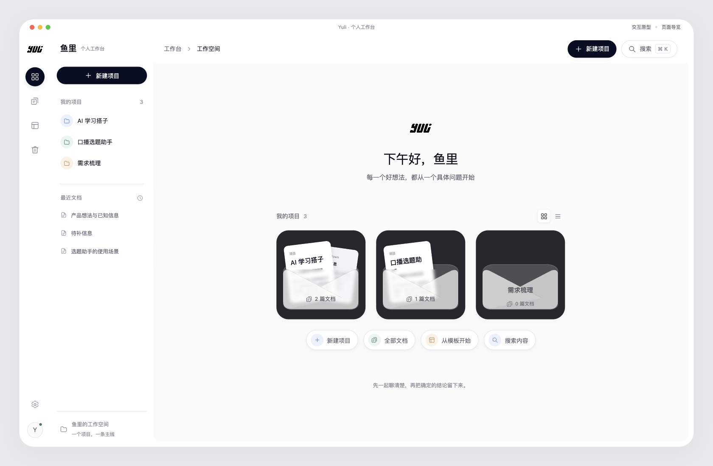
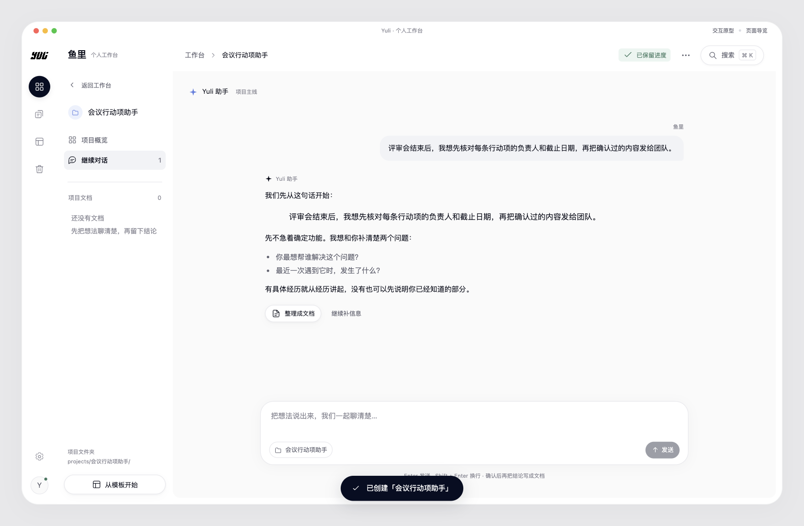
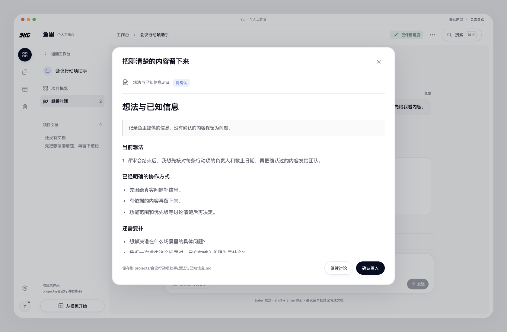
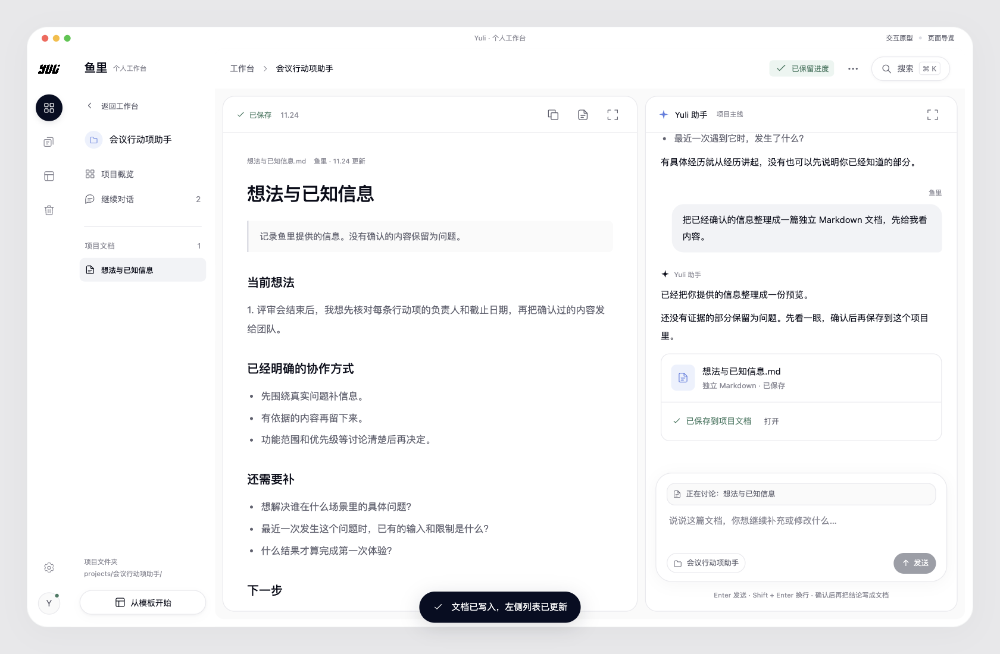

# 鱼里 · 个人工作台

把一个产品想法从讨论整理成一篇可以回看的文档。每个项目都有自己的对话和文档，下次打开，还能接着上次的问题聊。

[打开在线工作台](https://yulili-ai.github.io/yuli-pm-workbench/)

## 把一场评审会的想法存成文档

### 1. 新建项目，写下第一个问题

在首页点 **新建项目**，输入项目名称，例如「会议行动项助手」。「先记下一句话」是选填项。如果填写，点 **创建项目** 后，这句话会作为第一条消息发出。也可以先打开首页自带的「AI 学习搭子」，看看一个已有讨论和文档的项目。

> 评审会结束后，我想先核对每条行动项的负责人和截止日期，再把确认过的内容发给团队。

### 2. 在项目里讨论，决定哪些内容值得留下

助手会围绕这句话追问使用者和具体场景。想补充时，直接在底部输入框继续说。准备留下阶段性结论时，点回复下方的 **整理成文档**。

### 3. 预览，再决定是否写入

对话里会出现一张标有「等你确认」的文档卡片。点 **查看内容**，先读「当前想法」和「还需要补」，核对哪些是你说过的，哪些问题还没解决。

| 你想做什么 | 怎么操作 |
| --- | --- |
| 内容准确，保存到项目 | 在预览底部点 **确认写入**。 |
| 先返回对话，稍后再决定 | 点 **继续讨论**。这会关闭预览，卡片仍待确认。 |
| 放弃这次草稿 | 在对话卡片上点 **先不写**，已有文档保持原样。 |

### 4. 找回文档，继续修改

确认后，文档出现在左侧 **项目文档**。默认会自动打开这个项目的第一篇文档。桌面宽屏可以一边读正文，一边沿着右侧的项目对话继续聊。

要改某句话，可以选中正文，点 **引用到对话**，再输入修改要求，例如“把「截止日期」改成「约定完成日期」”。助手给出修改建议后，点 **查看修改** 对照内容，最后点 **确认修改**。以后也可以从 **全部文档** 或搜索重新打开它。

## 使用规则

- **一个项目，一条对话。** 同一件事回到原项目继续聊。要单独跟进另一个问题，可以新建项目。模板里的「讨论起点」会带入输入框，你可以改好再发送。
- **聊天和保存是两步。** 发送消息会留下讨论记录。只有确认写入或确认修改，项目里的文档才会新建或更新。
- **数据保存在当前浏览器。** 网页版使用预设回复演示交互，无需模型密钥。项目、文档和偏好保存在当前站点的浏览器数据里。换浏览器或设备不会自动同步，清除站点数据会丢失编辑。需要留存正文时，可用文档工具栏的 **复制 Markdown** 保存到自己的文件里。
- **误删可以找回。** 在 **回收站** 点 **恢复**，文档会回到原项目。确认永久删除后无法从回收站恢复。

## 常用操作

| 操作 | 入口或快捷键 |
| --- | --- |
| 查找项目、文档或对话原句 | **搜索内容**，或 Mac 按 **⌘K**，Windows 按 **Ctrl+K**。选中对话结果会定位到对应消息。 |
| 发送消息、输入换行 | 默认 **Enter** 发送，**Shift+Enter** 换行。可在 **设置 → 使用偏好** 切换成 **⌘/Ctrl+Enter** 发送。 |
| 只看正文 | 在文档工具栏点 **专注阅读**，按 **Esc** 退出。 |

## 本地打开

下载并解压仓库，保留文件的相对位置，用浏览器打开 `index.html`。页面使用原生 HTML、CSS 和 JavaScript，无需安装依赖。
